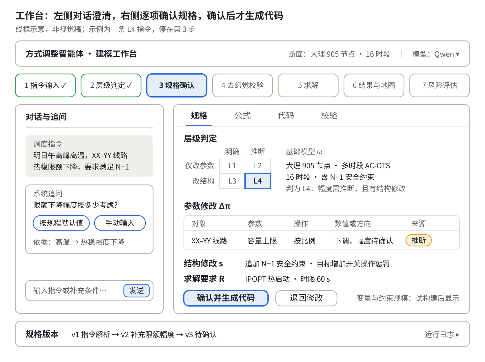
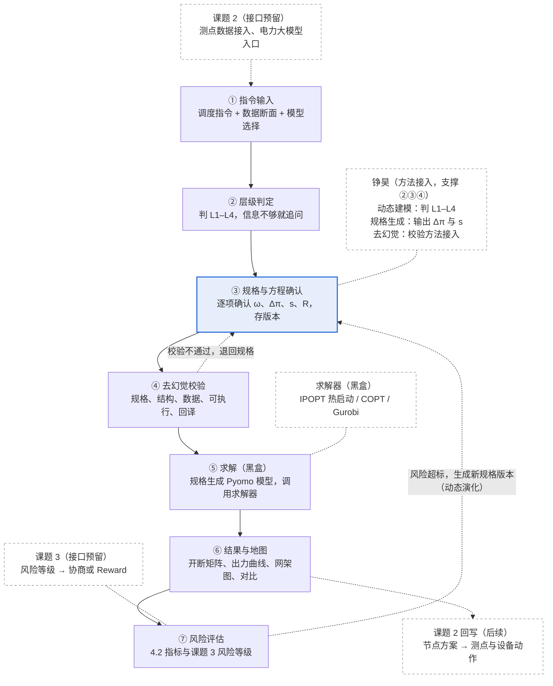

# 课题4方式调整智能体平台 · 建模工作台界面方案 v1

2026-11-12 · 伯宁

## 一、定位与设计原则

这版界面把“调度指令 → 模型规格 → 方程确认 → 校验 → 求解 → 风险评估”做成一条看得见、可确认、可退回的闭环，求解先当黑盒，目标是支撑 2027 年 1 月的中期检查。

中期考核的两项技术指标都落在建模和评估上，求解 ≤1 分钟是完成时（2028 年）的指标：

| 指标 | 中期（2027 年 1 月） | 完成时（2028 年） |
| --- | --- | --- |
| 4.1 建模与求解 | 模拟系统上万级整数决策变量的方式调整问题，完成从人类语言到数学问题的自动化建模，模型可用常用商业求解器求解 | 地区电网上完成自动化建模与分解；每 15 分钟滚动优化未来 4 小时的拓扑与机组出力，求解时间 ≤1 分钟 |
| 4.2 策略质量 | 模拟系统上，完成基于商业求解器所生成策略的质量评估指标计算 | 智能体生成的策略优于人工策略，满足全部静态 N−1 校验 |

两项都要先编制测试方案、经第三方专家评审，再由有检测资质的第三方机构测试并出具报告，所以界面必须能批量复现、全程留痕。

设计原则：

1. 流程闭环优先于单点性能：每个环节都可见、可确认、可退回。求解直接接入现有 IPOPT 热启动链路（96 个窗口 95 个达标），本期不再继续做加速。
2. 全部功能上墙，没做的标状态：课题 4 的研究内容在界面上都有位置，按“已实现 / 黑盒 / 接口预留 / 待开发”四种状态标注，沿用此前平台会议的口径。
3. 模型规格是唯一的中间产物：指令先变成结构化规格，用户确认后才生成代码；改需求就改规格，不直接改代码。
4. 基础模型固定，大模型只生成“改什么”：沿用 ProOPF 的思路，多时段 AC-OTS 与 N−1 的物理骨架由平台模板给出，大模型只输出参数修改 Δπ 和结构修改 s，从源头减少幻觉。
5. 按模块开发，可嵌入宿主平台：孙老师要求以功能为主、界面与博文老师侧对齐，所以模块独立、样式可替换；后端统一用 Python。
6. 每次运行可回放：输入、各版本规格、代码、求解日志、指标全部存档，支撑批量测评和第三方测试。

## 二、厂商界面能参照什么

可以参照：孙老师布置调研时就要求看各家的功能、性能和界面，调研结论里“先规格确认再实现测试”“诊断与反馈”“任务管理”三类工作流可以直接借。借的是交互方式，电力专用的内容要自己做。

| 参照对象 | 可借的界面做法 | 落到本平台 |
| --- | --- | --- |
| Gurobi Modeler | 先问业务目标，再逐项确认约束与数据，可点选项也可补充；规格、数学表达、代码是三个独立产物，改需求先改规格 | M2 的追问方式；M3 规格 / 公式 / 代码三栏 |
| Gurobi Explainer | 不可行分析（IIS）、可行性恢复（FeasRelax）、灵敏度分析三个入口，各有输入输出 | M4 校验不通过时的冲突定位和“允许调整项” |
| 杉数 COLORMind EDU | 对话逐步澄清需求，旁边是结构化模型，可对照编辑 | 工作台整体布局：左边对话，右边模型 |
| 阿里 MindOpt Copilot | 行业与场景入口（含电力能源）、提问设置、引用数据入口 | M1 的场景模板、模型与提问设置、数据断面引用 |
| 华为天筹求解助手 | 数据缺失、维度、类型自动检查；参数配置 → 求解 → 结果文件与日志 | M4 数据检查；M5 求解日志 |
| IBM Decision Optimization | 两个方案的输入、输出差异高亮，只显示差异项 | M6 / M7 调整前后、方案 A / B 对比 |
| IBM Bob | 规则库、模型定义文档、工程文件放在同一个工作区 | 建模规则与调度规程的知识库面板（待开发） |
| 华为算法设计 / LLM4AD | 候选代码 → 评估得分 → 迭代演化 → 最佳代码 | M9 求解策略演化（待开发） |

调研也没有找到同时验证 16 时段、拓扑与机组联合决策、N−1 校核和 60 秒交付的公开产品案例。下面四处是本平台必须自己做的：

- L1–L4 层级判定和 Δπ / s 结构化规格（来自 ProOPF）；
- 电力物理校验：潮流约束一致性、索引与网络耦合、N−1；
- 网架拓扑与地图上的方案展示；
- 跨课题接口：课题 2 的测点数据与大模型、课题 3 的风险等级与 Reward。

## 三、总体布局与主流程

主界面是一个“建模工作台”：顶部是数据断面与模型配置，下面一条七步流程条；左侧是对话与追问，右侧是规格 / 公式 / 代码 / 校验四个标签页，底部是规格版本与运行日志。



| 区域 | 内容 |
| --- | --- |
| 顶栏 | 平台名称；数据断面（大理 905 节点 · 16 时段）；模型选择 |
| 流程条 | 1 指令输入 → 2 层级判定 → 3 规格确认 → 4 去幻觉校验 → 5 求解 → 6 结果与地图 → 7 风险评估；已完成的步骤打勾，当前步骤高亮 |
| 左栏：对话与追问 | 调度指令原文；系统追问（选项按钮 + 自由补充）和推断依据；底部输入框 |
| 右栏：四个标签页 | 规格页依次是层级四宫格与判级理由、基础模型 ω、参数修改 Δπ 表（来源为“推断”的项标黄）、结构修改 s、求解要求 R，底部是“确认并生成代码”“退回修改”和模型规模；另有公式、代码、校验三页 |
| 底栏 | 规格版本链 v1 → v2 → v3；运行日志入口 |

示例停在第 3 步：系统把指令判为 L4，限额下降幅度是推断项，标黄等用户确认；确认之前不生成代码。

七个环节串成一条闭环，任何一步不通过都退回规格确认，不往下硬算：



图中两条虚线回路分别对应“运筹幻觉处置”和“动态演化”，虚线框是第五节接口清单里的外部接口。测评模式（M8）把 ①–⑦ 批量回放，M9 先占位，不画进主流程。

## 四、模块设计

九个模块里 M1–M4 是这次的重点：它们决定建模准不准，也正是中期 4.1 指标要测的部分；M5 用现有链路当黑盒，M9 只占位。表中“平台组”指伯宁和邵老师，具体分工周六再定。

| 模块 | 用户在界面上做什么 | 对应任务书 | 负责 | 中期演示状态 |
| --- | --- | --- | --- | --- |
| M1 输入与场景 | 输入调度指令，选数据断面和大模型 | 任务 1：调度指令与 SCADA 等多模态数据融合 | 平台组 | 已实现 |
| M2 语义解析与层级判定 | 查看系统判出的 L1–L4，改选或回答追问 | 任务 1：语义理解 | 铮昊（方法）、平台组 | 已实现 |
| M3 模型规格与方程确认 | 逐项确认参数修改、结构修改、目标与求解要求 | 任务 1：模型框架选择、参数智能配置 | 铮昊（方法）、平台组 | 已实现 |
| M4 去幻觉与校验 | 查看分层校验结果，按提示修正规格 | 运筹幻觉处置 | 铮昊（方法）、平台组 | 已实现 |
| M5 求解 | 选求解器，看进度、日志和耗时分解 | 指标 4.1：模型可用商业求解器求解 | 平台组（复用现有链路） | 黑盒 |
| M6 结果与地图 | 看开断方案、机组出力、网架图和前后对比 | 平台展示 | 平台组 | 已实现 |
| M7 风险评估与动态调整 | 看 4.2 指标和课题 3 风险等级，触发新一版规格 | 指标 4.2；任务 1 动态演化；任务 3 | 平台组、课题 3 | 已实现 |
| M8 测评模式 | 批量跑测试集，按层级统计，导出报告 | 中期第三方测试 | 平台组 | 已实现 |
| M9 问题分解与多智能体 | 页面占位，写明后续功能 | 任务 2、任务 4 | 方法组（待定） | 待开发 |

### M1 输入与场景

- 指令输入框：输入自然语言调度指令；旁边放常用场景模板（如检修、高温导致限额下降、新能源大发），点选后可以改写。
- 数据断面：选日期和起始时刻，默认滚动 16 个时段（15 分钟一段，共 4 小时）；数据来源可选节点模型 TXT（当前 905 节点数据）或课题 2 测点数据（接口预留）。
- 模型与提问设置：大模型可选本地 Qwen、ProOPF 微调模型、课题 2 大模型（接口预留）；提问设置控制是否追问、最多追问几轮。
- 语音输入：任务书的具身智能样机要求调度指令语音交互，先留按钮，标“待开发”。
- 输出：一条任务记录，含指令原文、断面引用和模型配置。

### M2 语义解析与层级判定

- 解析卡片：列出识别到的调整对象（母线、线路、机组、时段），并在指令原文上高亮对应字句。
- 层级四宫格：按两条判据点亮 L1–L4 中的一格，可人工改选。判据一是参数修改明确给出还是要从场景推断，判据二是要不要改模型结构。
- 推断链（仅 L2 / L4）：按 ProOPF 的“事件 → 机理 → 参数”展示，例如“极端高温 → 线路热稳裕度下降 → 调低线路容量上限”；推断出的方向和幅度必须由用户确认。
- 追问：信息不够时逐项追问，给选项按钮，也允许自由补充（参照 Gurobi Modeler）。
- 输出：层级，以及一份待确认的修改意图清单。
- 本期边界：ProOPF 评测里通用大模型在 L2 上准确率接近零，所以 P0 先做 L1 / L3，L2 / L4 放到 P1，推断结果一律人工确认。

### M3 模型规格与方程确认（核心页）

- 规格栏是一张可编辑表单，分四块：
    - 基础模型 ω：系统（大理 905 节点）、问题类型（多时段 AC-OTS）、时段数、是否含 N−1；
    - 参数修改 Δπ：每行一项，列为对象、参数、操作（按比例 / 设定值）、数值或方向、生效时段、来源（明确 / 推断）、原文依据；
    - 结构修改 s：问题类型、追加约束（如 N−1 安全约束、断面限额）、目标项（新增或替换，如开关操作惩罚）；
    - 求解要求 R：求解器、时限、收敛容差、输出项。
- 公式栏：渲染目标函数和约束，相对基础模型新增或改动的项高亮。
- 代码栏：由规格生成的 Pyomo 代码，只读；每段代码标出对应的规格条目，可双向跳转。算子库里已有的修改由模板确定性生成，库里没有的新约束才让大模型写代码，并标黄待审。
- 模型规模：显示整数变量数、连续变量数、约束数。按 Branch 1000 条记录、16 时段估算，开断变量最多约 1.6 万个，可直接对上 4.1 的“万级整数决策变量”。
- 操作：确认生成 / 修改后重新生成 / 退回 M2；每次确认存一个规格版本。

### M4 去幻觉与校验

- 五层校验，逐层亮红绿灯：
    1. 规格合法：对象存在，参数类型合法，幅度在允许范围内，结构修改属于允许的算子集合；
    2. 结构一致：索引、维度、网络耦合一致，例如开断一条线路时，潮流、容量和 N−1 约束同步修改；
    3. 数据检查：缺失、维度、类型、单位（参照华为天筹）；
    4. 可执行：试构建模型但不求解，报告规模和构建耗时；
    5. 语义回译：把规格翻回自然语言，与原指令逐条对照，标出多出来或漏掉的修改。
- 不通过时：定位到具体规格条目并给出修改建议，退回 M3。求解后不可行时，提供冲突定位（IIS）和允许调整项（参照 Gurobi Explainer）。
- 方法接入：铮昊的去幻觉方法作用在哪一层、输入输出是什么，今天下午确认。
- 输出：校验报告，随规格版本存档。

### M5 求解（黑盒）

- 求解器选择：IPOPT 热启动链路（已有）、COPT、Gurobi；可设时限和热启动开关。
- 运行面板：进度、状态、迭代日志；耗时分成读数据、建模、求解、N−1 校核四段显示。
- 本期边界：中期 4.1 和 4.2 都写的是“商业求解器”，所以保留 COPT / Gurobi 选项；IPOPT 链路作为快速模式，不再继续优化。

### M6 结果与地图

- 开断方案：时段 × 线路矩阵，断开的格子着色，可按电压等级筛选。
- 机组出力：各机组 16 个时段的出力曲线，越限处标红。
- 网架图：一期用拓扑示意图（节点—支路，按电压等级分层），开断线路画虚线，重载线路按负载率着色；二期叠加大理地理底图。
- 前后对比：调整前后或两个方案并排，只显示差异项（参照 IBM 方案比较）。
- 结果回写：节点方案映射回测点和设备动作属于课题 2 接口，孙老师已明确等主要功能完善后再做，先标“接口预留”。

### M7 风险评估与动态调整

- 4.2 指标面板：N−1 通过率、线路负载率指标、电压偏移指标、静态电压稳定裕度；新能源消纳率因缺新能源机组数据，暂不计算。
- 课题 3 风险：显示课题 3 智能体返回的风险等级和原因（接口预留）。
- 反馈有两条路，和课题 3 商定后先打通一条：
    - 协商：风险超标时生成调整建议（如收紧某条线路限额、追加约束），回到 M3 形成新一版规格；
    - Reward：把风险等级折算成奖励项，留给任务 3 的安全强化学习；强化学习按此前会议安排放到中期之后。
- 版本链：规格 v1 → v2 → v3，每一版写明改了什么、为什么改，这就是任务书“动态演化”在界面上的呈现。

### M8 测评模式

- 批量导入测试用例（指令 + 参考规格或参考目标值），按 L1–L4 分组运行。
- 统计各层级准确率（参照 ProOPF-B，用目标值比对判断对错）、平均耗时、模型规模和 4.2 指标。
- 每条用例可点开回放全过程；可一键导出测试报告，供第三方测试使用。

### M9 问题分解与多智能体（占位）

- 任务 2：问题类型识别、分解策略选择、子问题网络图，以及建模规则与调度规程的知识库（参照 IBM Bob 的规则库）。
- 任务 4：子问题智能体状态、协同过程、全局收敛情况。
- 中期前只放页面和功能说明，标“待开发”；是否要在中期演示，由老师定。

## 五、数据结构与接口清单

所有模块围绕一份“模型规格”交换数据：课题 2、铮昊的方法、求解器和课题 3 都读写这份规格或它的结果，所以接口格式先统一到它。字段参照 ProOPF 的 M = {ω, Δπ, s, R}，加上断面、版本和校验信息。

示例如下（字段为建议，数值仅作示意；value 为 null 表示幅度待用户确认）：

```json
{
  "task_id": "示例-001",
  "instruction": "明日午高峰高温，XX–YY 线路热稳限额下降，要求满足 N−1，尽量少动开关",
  "snapshot": {"source": "node_txt", "system": "dali_905", "start": "2026-11-13T12:00", "periods": 16, "step_min": 15},
  "level": "L4",
  "base_model": {"problem": "multi_period_AC_OTS", "n_minus_1": true},
  "delta_pi": [
    {"object": "branch:XX-YY", "param": "RATE_A", "operation": "scale", "direction": "decrease", "value": null,
     "periods": "12:00-16:00", "source": "inferred", "evidence": "高温"}
  ],
  "structural": {
    "constraints": [{"op": "add", "name": "N-1 security"}],
    "objective": [{"op": "add", "name": "switching action penalty", "beta": null}]
  },
  "solver_req": {"solver": "ipopt", "warm_start": true, "time_limit_s": 60},
  "version": {"id": 2, "parent": 1, "reason": "用户确认限额幅度"},
  "checks": {"legal": "pass", "consistency": "pass", "data": "pass", "build": "pass", "back_translation": "pending"}
}
```

层级不靠大模型自报，而是由规格推出：Δπ 全部明确且没有结构修改为 L1，含推断项且无结构修改为 L2，明确参数加结构修改为 L3，推断参数加结构修改为 L4。这样判级可以核对，也能直接用于 M8 按层级统计。

| 接口 | 方向 | 传什么 | 格式现状 / 建议 | 对接人 | 状态 |
| --- | --- | --- | --- | --- | --- |
| 节点模型数据 | 数据文件 → M1 | Bus / Gen / Branch 断面（当前 TXT：Bus 905 条、Gen 237 条、Branch 1000 条） | 分段 TXT，平台用 Python 读入 | 平台组 | 已有 |
| 课题 2 测点数据 | 课题 2 → M1 | 测点静态 / 动态数据，测点到节点的映射 | 现为按四类对象组织的静态、动态两组表（视频里是 XLSX，口头称 CSV）；单位字典、标识范围、API 未定 | 嘉明（侯佳萱数据组） | 接口预留 |
| 课题 2 大模型 | M1 / M2 ↔ 课题 2 | 指令解析、规格生成 | 建议 OpenAI 兼容对话接口，输出规格 JSON | 课题 2，待定 | 接口预留 |
| 动态建模与去幻觉 | M2–M4 ↔ 铮昊方法 | 输入指令和断面；输出规格（Δπ、s）与校验结果 | 规格 JSON | 铮昊 | 今天下午确认 |
| 求解器 | M5 | 规格 → Pyomo 模型 → 开断、出力、潮流结果 | Python 函数调用 | 平台组 | 已有（IPOPT 链路） |
| 课题 3 风险评估 | M6 → 课题 3 → M7 | 输入方案（开断、出力、潮流）；输出风险等级、原因、Reward 项 | 未定 | 课题 3，待定 | 接口预留 |
| 结果回写测点 | M6 → 课题 2 | 节点方案 → 测点结果与设备动作 | 未定；需要真实设备与控制点的关联规则 | 嘉明 | 主要功能完善后再做 |
| 宿主平台嵌入 | 全部模块 → 博文老师侧平台 | 页面嵌入、风格对齐、账号 | 未定 | 博文老师 | 后续 |

## 六、技术实现与开发分期

后端用 Python，求解直接复用现有 IPOPT 热启动链路；按三期推进，P1 结束时完整建模链可演示，1 月留给中期测试准备。

- 后端：Python + FastAPI；求解耗时较长，放后台任务执行，日志通过 WebSocket 推到前端。
- 大模型调用：本地 Qwen 用 vLLM 部署成 OpenAI 兼容接口；模型名做成配置项，可切换到 ProOPF 微调模型或课题 2 的模型。
- 建模与求解：规格 → 基础 OTS 模板 + 修改算子 → Pyomo 模型；IPOPT 链路直接复用，另接 COPT / Gurobi，对应中期指标里“商业求解器”的表述。
- 前端：框架与邵老师现有模板保持一致（周六确认）；曲线和矩阵用 ECharts，公式用 KaTeX，代码查看用 Monaco 编辑器。
- 存储：每次运行一条记录，含各版本规格、代码、日志、结果和指标；先用 SQLite 加文件目录。

排期为建议，待老师确认；本方案评审通过后进入 P0。

| 阶段 | 时间 | 主要内容 | 验收节点 |
| --- | --- | --- | --- |
| P0 最小闭环 | 11 月下旬，约 2 周 | L1 / L3 指令（参数明确）；规格 / 公式 / 代码三栏；规格、数据、可执行校验；接 IPOPT 黑盒，算 4.2 指标 | P0 验收：L1、L3 各一条指令走通 ①–⑦ |
| P1 完整建模链 | 12 月 | L2 / L4 语义推断与确认；铮昊去幻觉方法接入；课题 3 接口先通一条；拓扑图、方案对比、测评模式 | P1 验收：L1–L4 都能演示，课题 3 接口联通 |
| P2 中期准备 | 2027 年 1 月 | 第三方测试方案与测试集；万级整数变量建模测试；地图（视老师意见）；嵌入宿主平台、风格对齐 | 中期检查：4.1、4.2 中期指标，第三方测试 |

P0 只要求 L1、L3 两类参数明确的指令走通 ①–⑦，L2 / L4 和跨课题接口放到 P1；P2 不加新功能，只做测试、地图和嵌入。

## 七、待确认问题

三次沟通各要拿到一个结论：今天下午和铮昊定方法接口，周六和邵老师定模板与分工，之后请孙老师、博文老师定范围和跨课题口径。

### 铮昊（今天下午）

- [ ] 动态建模模块现在输出什么：直接生成代码，还是能输出 Δπ / s 这样的结构化规格？
- [ ] ProOPF 用 MATPOWER 代码实现，基础模型是单时段 AC-OPF；平台后端是 Python、多时段 AC-OTS 加 N−1。是改成生成 Pyomo 代码，还是只用它生成规格、由平台模板建模？
- [ ] 基础模型和允许的修改算子集合（Ωπ、Ωs）要扩展到多时段 OTS，由谁整理？
- [ ] L1–L4 判级在推理时由谁做：模型自报，还是按第五节的规则从规格推出？
- [ ] 去幻觉方法作用在哪一步（解析、规格、代码），输入什么，返回什么（通过与否、原因、修正后的规格）？
- [ ] 微调过的 Qwen3-30B-A3B 能否部署成接口给平台调用，需要多少显存和并发？

### 邵老师（周六）

- [ ] 现有界面模板做到哪一步：有哪些页面，能否运行，前后端用什么技术栈？
- [ ] 他理解的界面需求和本方案差在哪，哪些页面可以直接复用？
- [ ] 平台组分工：前端、后端、数据接入、宿主平台对接分别由谁负责？
- [ ] 博文老师侧平台有没有界面规范（组件、配色、嵌入方式）？
- [ ] 905 节点数据的断面选取准则（孙老师此前请邵老师设计）进展如何？

### 孙老师、博文老师

- [ ] 本方案的流程和模块划分是否认可？M9 中期前是否只做占位？
- [ ] 课题 3 的风险反馈先做协商还是 Reward？输入输出由谁定？
- [ ] 中期演示是否必须有大理地理地图，还是拓扑示意图即可？
- [ ] 中期第三方测试的测试集由谁出、按什么口径判对错（例如按目标值比对）？
